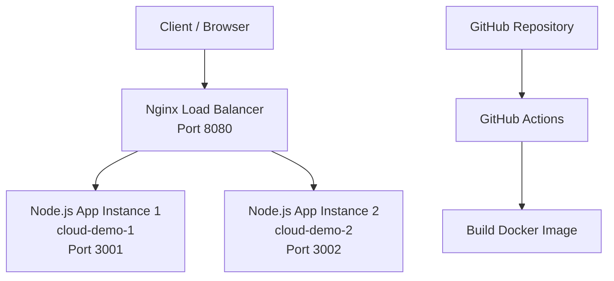

# Cloud Deployment Demo — Walkthrough

## 1. Introduction

This project demonstrates a containerized Node.js application using Docker, two independent application containers, and an Nginx load balancer.

The application provides two endpoints:

- `/` — Displays application and instance information.
- `/health` — Returns a health-check response.

The project uses a local setup to avoid unexpected cloud charges.

## 2. Repository Files

- `src/server.js` — Contains the Express application, root endpoint, and health endpoint.
- `Dockerfile` — Uses a Node Alpine base image, installs production dependencies, copies the source code, exposes port 3000, and runs the application as the non-root `node` user.
- `nginx-default.conf` — Configures Nginx to forward requests to two application instances.
- `.github/workflows/docker-build.yml` — Builds the Docker image through GitHub Actions when code is pushed to the `main` branch.
- `README.md` — Contains project documentation and setup instructions.

## 3. Architecture



Both application containers use the same Docker image. Nginx receives requests on port 8080 and forwards them to either application container.

## 4. Show the Docker Containers

Run in PowerShell:

```powershell
docker ps
```

The following containers should be running:

- `cloud-demo-1` — Application on port 3001.
- `cloud-demo-2` — Application on port 3002.
- `cloud-demo-lb` — Nginx load balancer on port 8080.

If they are not running, start them:

```powershell
docker start cloud-demo-1 cloud-demo-2 cloud-demo-lb
```

## 5. Test the Application Instances

Run:

```powershell
curl.exe http://localhost:3001/
curl.exe http://localhost:3002/
```

The first response should identify `instance-1`, and the second should identify `instance-2`.

This confirms that two separate application instances are running.

## 6. Test Health Checks

Run:

```powershell
curl.exe http://localhost:3001/health
curl.exe http://localhost:3002/health
```

Both instances should return a healthy status.

In a cloud deployment, a managed load balancer could use this endpoint to determine whether a container is ready to receive traffic.

## 7. Demonstrate the Nginx Load Balancer

Run:

```powershell
curl.exe http://localhost:8080/
curl.exe http://localhost:8080/
curl.exe http://localhost:8080/health
```

Port 8080 is the load-balancer entry point. Nginx receives the request and forwards it to one of the two application containers. The response includes the instance ID, showing which backend handled the request.

If both requests show the same instance, the load balancer can still be working: these particular requests may be assigned to the same backend.

## 8. Demonstrate Failover

Stop the first application container:

```powershell
docker stop cloud-demo-1
```

Send a request through the load balancer:

```powershell
curl.exe http://localhost:8080/
```

The response should show:

```text
instance-2
```

The request should succeed because the second container remains available, provided the Nginx configuration handles the failed upstream appropriately.

Restart the first container:

```powershell
docker start cloud-demo-1
```

Check its health:

```powershell
curl.exe http://localhost:3001/health
```

The first container should be running again, and its health endpoint should respond.

## 9. GitHub Actions

Open the GitHub repository:

https://github.com/25jaiswalkn-crypto/Cloud-deployment-demo-free

Then:

1. Click the **Actions** tab.
2. Click **Docker Build Check**.
3. Open the latest successful workflow run.
4. Open the job and show the **Build Docker image** step.

The workflow runs on pushes to the `main` branch. It checks out the code and builds the Docker image on GitHub's runner.

This provides continuous integration and confirms that the Dockerfile remains buildable.

**Limitation:** The workflow only builds the image. It does not push the image to a registry or deploy the application to AWS.

## 10. Architecture and Limitation

The architecture is:

1. The client sends a request to Nginx on port 8080.
2. Nginx forwards the request to either application container on port 3001 or port 3002.
3. Both containers run the same Node.js Docker image.

The original task asks for a public cloud load balancer and at least two cloud instances. These billable AWS resources were not created because AWS ECS, Fargate, and an Application Load Balancer can generate charges.

Instead, the equivalent architecture was implemented and tested locally using Docker and Nginx.

In a production cloud deployment, the local Nginx container would be replaced with a managed application load balancer, and the two local containers would run as managed cloud tasks.

## 11. Final Checks Before Submission

Run these commands in PowerShell:

```powershell
git status
docker ps
curl.exe http://localhost:8080/health
```

Expected results:

- Git reports a clean working tree.
- Docker shows `cloud-demo-1`, `cloud-demo-2`, and `cloud-demo-lb`.
- The health response contains:

```json
{
  "status": "healthy"
}
```

## 12. Submission Links

- **GitHub Repository:** https://github.com/25jaiswalkn-crypto/Cloud-deployment-demo-free

**Important:** This project is a free local implementation of the required architecture. The application has not been publicly deployed on AWS.
