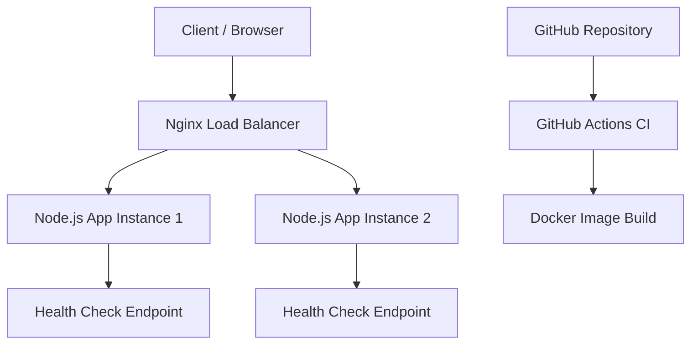


# Cloud Deployment Demo

## 1. Project Overview

Cloud Deployment Demo is a containerized Node.js web application that demonstrates important cloud computing and DevOps concepts.

The project covers:

- Building a web service using Node.js and Express
- Containerizing the application using Docker
- Running multiple independent application instances
- Performing health checks
- Distributing traffic using an Nginx load balancer
- Demonstrating failover when one application instance stops
- Automatically building the Docker image using GitHub Actions

### Application Endpoints

| Endpoint | Description |
|---|---|
| `GET /` | Returns application information, hostname, instance ID, version, and timestamp. |
| `GET /health` | Returns the health status of the application. |

## 2. Why I Chose This Project

I chose this project because cloud deployment is an important part of modern software development. Writing an application is only one part of the development process; the application must also be packaged, deployed, monitored, updated, and kept available for users.

This project helped me understand how Docker containers, multiple application instances, load balancing, health checks, GitHub, and CI/CD work together. These are foundational concepts used in cloud engineering, DevOps, backend development, and site reliability engineering.

## 3. Where This Type of System Is Used

This architecture can be used for:

- Web applications and REST APIs
- E-commerce websites
- Banking and payment services
- Social media platforms
- Educational platforms
- Business dashboards
- Mobile application backends
- Services that require reliability, scalability, and automated deployments

In a production environment, the local Nginx load balancer could be replaced by a managed cloud load balancer, and the local Docker containers could run on AWS ECS, Google Cloud Run, Azure Container Apps, or Kubernetes.

## 4. Architecture



### Components

| Component | Purpose |
|---|---|
| Node.js and Express | Runs the web application and API endpoints. |
| Docker | Packages the application and its dependencies. |
| Docker containers | Run two independent application instances. |
| Nginx | Receives requests and forwards them to the application instances. |
| GitHub | Stores the source code and commit history. |
| GitHub Actions | Automatically builds the Docker image after a push to `main`. |

## 5. Project Structure

```text
cloud-deployment-demo-new/
├── .github/
│   └── workflows/
│       └── docker-build.yml
├── src/
│   └── server.js
├── .dockerignore
├── .gitignore
├── Dockerfile
├── nginx-default.conf
├── nginx.conf
├── package.json
├── package-lock.json
└── README.md
```

## 6. Application Endpoints

### Root Endpoint

**Request:**

```http
GET /
```

**Example Response:**

```json
{
  "message": "Cloud deployment demo is running",
  "version": "1.0.0",
  "hostname": "container-hostname",
  "instanceId": "instance-1",
  "timestamp": "2026-10-11T12:00:00.000Z"
}
```

The response provides information about the running application instance.

### Health Endpoint

**Request:**

```http
GET /health
```

**Example Response:**

```json
{
  "status": "healthy",
  "hostname": "container-hostname",
  "timestamp": "2026-10-11T12:00:00.000Z"
}
```

The `/health` endpoint returns HTTP status `200` when the application is healthy.

## 7. Requirements

Install the following software:

- Node.js
- npm
- Git
- Docker Desktop
- VS Code or another code editor

## 8. Run the Application Directly with Node.js

Open a terminal in the project directory and execute:

```bash
npm install
npm start
```

Test the endpoints from another terminal:

```powershell
curl.exe http://localhost:3000/
curl.exe http://localhost:3000/health
```

## 9. Build and Run with Docker

### Build the Docker Image

```bash
docker build -t cloud-deployment-demo:local .
```

### Run One Container

```bash
docker run --rm -p 3000:3000 cloud-deployment-demo:local
```

The application will be available at:

http://localhost:3000/

## 10. Run Two Application Instances

### Start the First Instance

```bash
docker run -d --name cloud-demo-1 -p 3001:3000 -e INSTANCE_ID=instance-1 cloud-deployment-demo:local
```

### Start the Second Instance

```bash
docker run -d --name cloud-demo-2 -p 3002:3000 -e INSTANCE_ID=instance-2 cloud-deployment-demo:local
```

### Test Both Instances

```powershell
curl.exe http://localhost:3001/
curl.exe http://localhost:3002/
curl.exe http://localhost:3001/health
curl.exe http://localhost:3002/health
```

### Check Running Containers

```bash
docker ps
```

Each container runs an independent application instance with its own instance ID.

## 11. Run the Local Nginx Load Balancer

Start the load balancer from the project directory using PowerShell:

```powershell
docker run -d --name cloud-demo-lb -p 8080:80 --add-host=host.docker.internal:host-gateway -v "${PWD}\nginx-default.conf:/etc/nginx/conf.d/default.conf:ro" nginx:alpine
```

### Send Requests Through Nginx

```powershell
curl.exe http://localhost:8080/
curl.exe http://localhost:8080/health
```

The load balancer entry point is:

http://localhost:8080/

Nginx forwards traffic to the two application instances on ports `3001` and `3002`.

## 12. Failover Demonstration

Failover demonstrates how the application can continue serving requests when one instance stops.

### Stop One Application Instance

```bash
docker stop cloud-demo-1
```

### Test the Load Balancer

```powershell
curl.exe http://localhost:8080/
```

If the Nginx upstream configuration supports handling the unavailable instance, the remaining healthy instance should continue serving requests.

### Restart the Stopped Instance

```bash
docker start cloud-demo-1
```

This demonstrates the importance of multiple application instances and load balancing for service availability.

## 13. GitHub Actions CI

The GitHub Actions workflow is located at:

```text
.github/workflows/docker-build.yml
```

It runs when code is pushed to the `main` branch or when a pull request targets `main`.

### Workflow Steps

1. Checks out the repository.
2. Builds the Docker image.
3. Checks whether the Dockerfile and application can be packaged successfully.

### View the Workflow

1. Open the GitHub repository.
2. Click the **Actions** tab.
3. Select **Docker Build Check**.
4. Open the latest workflow run to inspect its status and logs.

This workflow demonstrates Continuous Integration (CI) by automatically validating the Docker build.

## 14. Testing Results

The following tests were completed successfully:

- Node.js application started locally.
- Docker image built successfully.
- First Docker instance responded on port `3001`.
- Second Docker instance responded on port `3002`.
- Both `/health` endpoints returned a healthy status.
- Nginx load balancer responded on port `8080`.
- One instance was stopped, and the remaining instance continued serving requests.
- GitHub Actions Docker build workflow was added and pushed to the repository.

## 15. Cloud Deployment Status and Cost Decision

The original task describes deploying two application instances behind a public managed cloud load balancer. I did not create AWS ECS, AWS Fargate, or an AWS Application Load Balancer because these resources may generate charges, and I wanted to avoid unexpected costs.

Instead, this project demonstrates the core architecture locally using Docker and Nginx. The local setup allows me to explore the application, containers, health checks, load balancing, failover, GitHub, and CI/CD without creating paid cloud resources.

A production cloud deployment could replace the local components with the following:

| Local Component | Production Equivalent |
|---|---|
| Docker containers | Managed container tasks or services |
| Local Nginx | Managed application load balancer |
| Local port mapping | Public cloud networking and routing |
| GitHub Actions build | Build, container registry push, and deployment pipeline |

## 16. Approximate Cost

| Resource | Cost in This Implementation |
|---|---|
| Node.js and Express | Free and open source |
| Docker Desktop | No separate project-specific charge assumed; licensing terms may apply |
| Nginx Docker image | Free and open source |
| GitHub repository | Free for a public repository |
| GitHub Actions | Uses the applicable usage allowance; monitor usage |
| AWS ECS, Fargate, and ALB | Not created, to avoid cloud charges |

Actual costs depend on usage, account plans, and applicable licensing terms.

## 17. AI/LLM Usage Declaration

An AI coding assistant was used for explanations, project guidance, command suggestions, and code drafting. I reviewed the generated code, ran the commands, tested the endpoints, inspected Docker containers, corrected the Nginx configuration, and documented the implementation.

## 18. Cleanup Commands

After the demonstration, stop and remove the local demonstration containers:

```bash
docker rm -f cloud-demo-lb cloud-demo-1 cloud-demo-2
```

This removes only the specified local containers. It does not delete the Docker image or GitHub repository.
